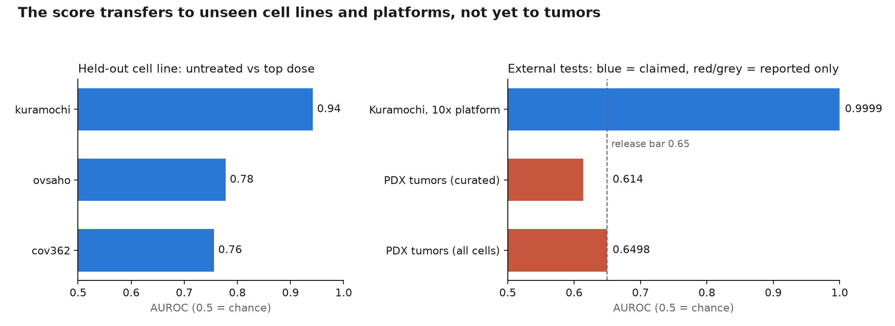

# parpi-resistance

[](https://github.com/sachitsatyal/parpi-resistance/actions/workflows/ci.yml)
[](https://huggingface.co/OWNER/parpi-resistance)
[](https://huggingface.co/spaces/OWNER/parpi-resistance-app)

A reproducible single-cell score of how far ovarian cancer cells have **adapted to the PARP
inhibitor olaparib**. It extends the hierarchical attention model of *Attention-Based
Hierarchical Graph Autoencoder for Dose-Specific Single-Cell Resistance Dynamics* (Satyal,
Long, Gao) to cell-level learning, validated on cell lines and a sequencing platform it never
saw during training.



**Status (v0.1, in vitro):**

- **Unseen cell lines:** trained on three ovarian lines (Kuramochi, COV362, OVSAHO; 31,762
  cells), the score ranks the doses of a held-out line (Spearman 0.70–0.99) and separates
  untreated from top-dose cells (AUROC 0.76–0.94).
- **Unseen platform:** the same line on 10x instead of inDrop gives AUROC 0.9999.
- **Not tumors:** a pre-registered test on patient-derived xenografts scored AUROC 0.614 (bar
  0.65). The tool is therefore scoped to cell-line experiments.

> Research use only. Not a diagnostic, and not a tumor or patient resistance score.
> Compare samples within one experiment: absolute levels shift between cell lines.

## What it returns

For every cell in a single-cell RNA-seq sample:

- an **adaptation score**: 0 = untreated, 1 = adapted to the top training dose (320 µM),
- an ensemble **uncertainty** (not yet calibrated; it understates the real error),
- the **pathways** behind the score,
- **dose-response curves** of pathway activity with bootstrap bands; doses outside the
  measured range are flagged, not predicted.

## Quick start

```bash
# Environment from the lockfile (Python ≥ 3.10, https://docs.astral.sh/uv/)
uv sync --all-extras

# End-to-end on synthetic data with a planted signal (~1 min)
uv run parpi reproduce -c configs/smoke.yaml

# The release run on the public GEO data (downloads ~400 MB)
uv run parpi reproduce -c configs/release.yaml
uv run parpi gate -c configs/release.yaml      # exits non-zero unless the release criteria pass
uv run python scripts/make_readme_figure.py    # redraws the figure above from the metrics
```

## Use a trained model

```bash
parpi predict sample.h5ad -m hf://OWNER/parpi-resistance@v0.1.0 -o predictions.csv
parpi dose-curve -m hf://OWNER/parpi-resistance@v0.1.0 -o curve.csv
docker run --rm -p 7860:7860 -e PARPI_MODEL=hf://OWNER/parpi-resistance@v0.1.0 \
  ghcr.io/sachitsatyal/parpi-resistance:latest     # web app on http://localhost:7860
```

```python
from parpi.bundle import ModelBundle
from parpi.data.readers import read_any

bundle = ModelBundle.load("hf://OWNER/parpi-resistance@v0.1.0")
pred = bundle.predict(read_any("sample.h5ad"))  # one row per cell
```

Inputs: `.h5ad`, 10x `.h5`, 10x matrix folders, or CSV/TSV counts; raw counts, HGNC symbols.

## How the results were obtained

| Practice | How it is enforced |
|---|---|
| Honest splits | Whole doses, then whole cell lines are held out; tumor data never trains or selects a model |
| Strong baselines | Every metric sits next to "predict the mean", "copy the nearest dose" and a depth-only model |
| Labels are targets only | No label is ever a model input |
| Model choice is earned | Ridge, gradient boosting and the hierarchical network compete; the simpler model wins ties |
| Pre-registration | Feature variants, the selection rule and the single tumor test were logged before results existed |
| Gated releases | `parpi gate` blocks publishing unless the claimed tests pass |
| Traceable results | Config hash, git commit, package versions and data/gene-set SHA-256s stored with each model |
| Reproducible | `uv.lock`, checksummed downloads, seeded deterministic training, 45+ tests in CI |
| No hand-typed numbers | The model card and the figure are generated from the run's metrics |

More: [design](docs/DESIGN.md) · [data](docs/DATA.md) · [every decision and why](docs/DECISIONS.md) ·
[deployment](docs/DEPLOYMENT.md)

## Repository layout

```
configs/            run configs (release, multiline_a/b, smoke, ...) + one file per dataset
src/parpi/          data/, models/, preprocess, evaluation, pipeline, bundle, report, cli
app/                Gradio web app (logic.py is unit-tested)
scripts/            diagnostics, README figure, Hugging Face Space deployment
tests/              pytest suite on synthetic data with a planted signal
.github/workflows/  ci.yml · train.yml (manual real-data run) · release.yml (tag -> publish)
```

## Citation

Data: França et al., *Cellular adaptation to cancer therapy along a resistance continuum*,
Nature 631, 876–883 (2024), GEO SuperSeries GSE247691. Model architecture: Satyal, Long, Gao,
*Attention-Based Hierarchical Graph Autoencoder for Dose-Specific Single-Cell Resistance
Dynamics*. See `CITATION.cff`.
